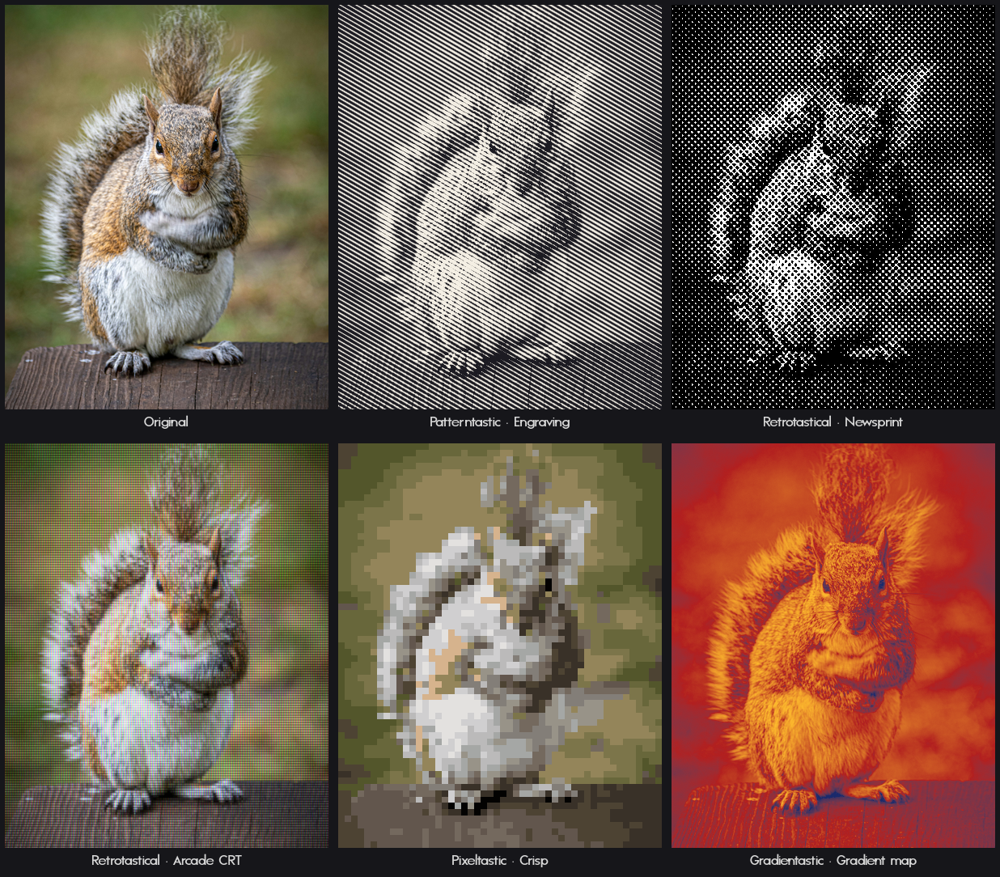
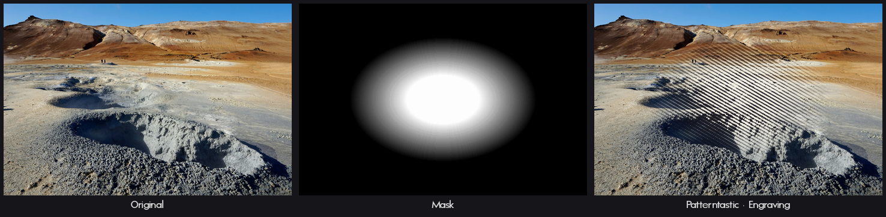
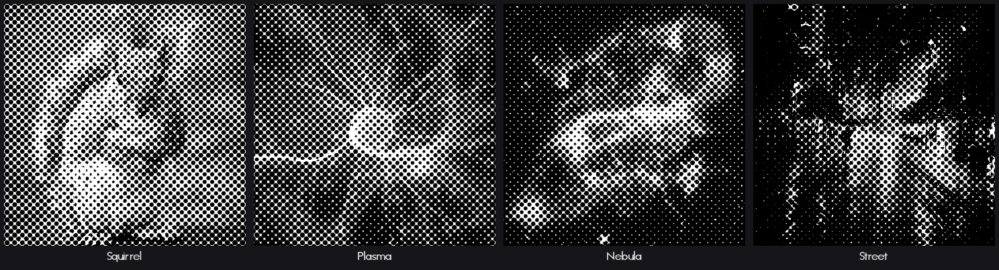
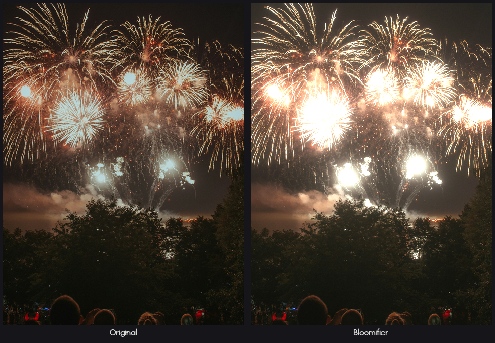

# 8bf-host


8bf-host runs Photoshop-compatible filter plug-ins (`.8bf` files) without Photoshop. It has two front ends: a command line that filters image files, and an HTTP server that filters images sent to it. It runs on Linux, Windows and macOS. On Linux, Windows filters run under Wine.

It works without an image editor attached: apply a filter to a folder of scans, run one as a build step, or offer it to other programs as a service. See [Why 8bf-host exists](docs/background.md) for the longer story.

It handles 8- and 16-bit RGB and grayscale images, selections, and saved presets. CMYK, Lab and floating-point images are not supported, and some commercial filters refuse to run outside Photoshop. Read [Compatibility](docs/compatibility.md) before depending on it.

## Check your plug-in licenses

Being able to load a filter does not mean its license lets you use it this way. Read the EULA of every 8bf plug-in before running it with 8bf-host. Some commercial licenses only permit use inside a supported graphics program, forbid batch or other non-interactive use, or restrict server and network deployment. Running a filter from the command line, in a build or behind the HTTP server can fall outside those terms. You are responsible for making sure your use complies with each plug-in's license.

## Installation

You need Rust 1.88 or later to build from source:

```console
$ cargo install --path .
$ 8bf-host --version
8bf-host 0.1.0
```

Release builds are static Linux binaries for x86-64 and ARM, 64-bit and 32-bit Windows builds, and a universal macOS binary. The Windows builds need only system DLLs. The macOS binary is not signed or notarized, so macOS blocks it on first run until you allow it (or run `xattr -d com.apple.quarantine` on it).

On Linux, Windows filters run in the Windows build of 8bf-host under Wine. [Windows filters on Linux](docs/wine.md) covers the setup.

## Quick start

```console
$ 8bf-host --plugin-dir ~/filters list
8c8224326f39  Wine/Invert  under Wine (win-x64, /home/you/.local/lib/8bf-host/8bf-host-win-x64.exe)
$ 8bf-host run Wine/Invert photo.png inverted.png
$ 8bf-host run "Acme/Unsharp Mask" sample.png check.png --dialog --save-preset unsharp.json
$ 8bf-host run "Acme/Unsharp Mask" scan.tif sharp.tif --preset unsharp.json
$ 8bf-host serve
8bf-host 0.1.0 serving 3 filters on http://127.0.0.1:8780 (isolated workers)
$ 8bf-host doctor
```

## Examples

One photo through five filters. Each one is a single `8bf-host run` with a preset:



```console
$ 8bf-host run "Distortionary/Patterntastic..." squirrel.png squirrel-engraving.png --preset engraving.json
$ 8bf-host run "Distortionary/Pixeltastic..." squirrel.png squirrel-pixels.png --preset pixels.json
```

`--mask` passes a selection. The filter's result is blended through it, soft edges included:



```console
$ 8bf-host run "Distortionary/Patterntastic..." mudpots.png mudpots-engraving.png --preset engraving.json --mask mask.png
```

One preset, replayed over a folder of photos without opening the filter's dialog:



Bloomifier on fireworks:



The filters shown are Windows 8bf plug-ins, run on Linux under Wine. Photo credits are in [docs/images/CREDITS.md](docs/images/CREDITS.md).

## Documentation

- [Using the command line](docs/cli.md): finding filters, running them, presets, repeated runs, exit codes
- [Using the HTTP server](docs/server.md) and the [HTTP API reference](docs/http-api.md)
- [Configuration](docs/configuration.md)
- [Where filters run](docs/where-filters-run.md): in-process, worker processes, Wine and Rosetta
- [Compatibility](docs/compatibility.md): what works and known limitations
- [Troubleshooting](docs/troubleshooting.md)
- [Project layout](docs/architecture.md)
- [Development](docs/development.md), including fuzzing
- [Releasing](docs/releasing.md)

## License

Licensed under either of:

- Apache License, Version 2.0 ([LICENSE-APACHE](./LICENSE-APACHE) or
  http://www.apache.org/licenses/LICENSE-2.0)
- MIT license ([LICENSE-MIT](./LICENSE-MIT) or
  http://opensource.org/licenses/MIT)

at your option.

### Contribution

Unless you explicitly state otherwise, any contribution intentionally submitted
for inclusion in the work by you, as defined in the Apache-2.0 license, shall be
dual licensed as above, without any additional terms or conditions.

---

[Distortionary.com](https://distortionary.com)
